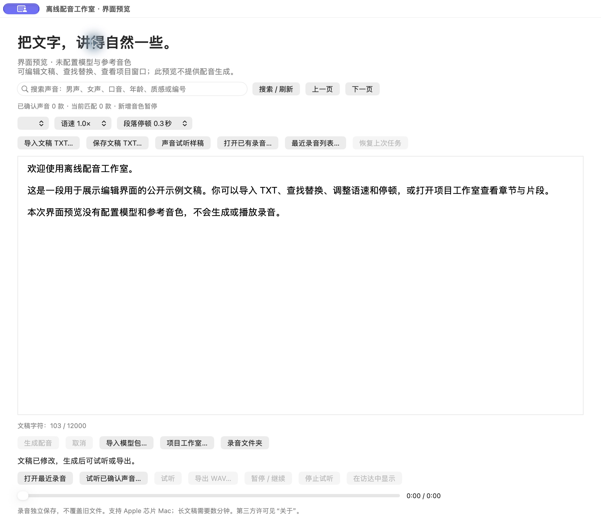

# 离线配音工作室 · 开源版 2.3

原生 macOS 配音与旁白工程工具。自有应用源码采用 [MIT License](LICENSE)。

本仓库是 2.3 的独立源码发布，不包含历史私有仓库或验收资料，也不附带原使用者的35款声音参考、试听、录音、工程或模型权重。它不是包含模型的即装即用安装包。



*真实原生窗口截图：未配置模型与参考音色的界面预览，没有生成或播放录音。*

## 最快跑起来

**先看界面：** Apple芯片Mac、macOS 26.2或更新（实际开发运行于26.2，界面预览另在27.0.1上跑通过）及Python3.9+；需安装Apple命令行工具（尚未安装时执行 `xcode-select --install`）。不用先下载MLX、配音模型或参考声。

```sh
git clone https://github.com/spinodehong-web/offline-voice-studio-open-source.git
cd offline-voice-studio-open-source
python3 tools/preview_app.py --open
```

不使用Git也可[下载最新版源码ZIP](https://github.com/spinodehong-web/offline-voice-studio-open-source/archive/refs/heads/main.zip)，解压并进入目录后运行上面的第三条命令。

首次会编译并打开真正的原生界面；之后直接打开 `build/OfflineVoiceStudioPreview.app`。可编辑文稿、查找替换、查看项目窗口。预览使用独立数据目录，生成按钮保持禁用。

- `git pull` 或改动源码后，先正常退出预览，再用 `python3 tools/preview_app.py --rebuild --open` 重新编译；运行中的预览和另一项正在进行的构建都会阻止重建，不会强制退出。它只删除上次预览产物（`build/OfflineVoiceStudioPreview.app`、`build/PreviewSwiftModuleCache` 及两个暂存源文件），不动 `build/` 里其他内容。
- 编译成功后会删除约200MB的Swift模块缓存 `build/PreviewSwiftModuleCache`，App本身不到1MB；想保留缓存加 `--keep-cache`。
- 预览数据目录是 `~/Library/Application Support/Offline Voice Studio Open Source Preview/`。预览自动生成的 `library-request-UUID.json` 和 `Logs/run-UUID.log` 各保留最新5份，清理记录写入运行日志。非预览目录、目录链接、手工命名的文件，以及文稿、工程、录音不自动清理；环境变量也不能扩大清理范围。需要进一步整理时，先退出预览，再仅移走确认不需要的临时文件。它与开源版、原安装版的数据目录互不相干。

**要实际配音：** 界面预览不是可搬移安装包，不具备完整配音环境。先按下面的“环境与资源”准备Python3.12独立运行时、FFmpeg、ASR和自己有权使用的参考声，再按“构建”执行；最后用“导入模型包”导入Base模型。仓库目前提供源码下载，没有承诺下载后即可直接配音的App/DMG。

若已准备好 `runtime/`、`local-assets/resources/`、本地参考声及模型目录，最短完整流程是：

```sh
python3 tools/add_local_voice.py --output local-assets/voices \
  --id local-voice --name '我的本地声音' \
  --wav /path/to/owned-reference.wav --text-file /path/to/transcript.txt \
  --listening-confirmed
python3 tools/build_app.py --runtime runtime \
  --assets local-assets/resources --voices local-assets/voices \
  --output dist/OfflineVoiceStudioOpenSource.app
python3 tools/package_models.py --models /path/to/models --output dist/model-packs
open dist/OfflineVoiceStudioOpenSource.app
```

打开后导入 `dist/model-packs/VoiceModel-Identity.zip`，选择本地声音，输入一小段文稿，再生成、试听、导出WAV。这里的路径是占位示例，资源不会被脚本自动下载。`--listening-confirmed` 只适用于本人确实听过并确认的参考录音。

## 能做什么

- 中文、英文文稿配音，文稿计数、导入、查找替换、撤销重做。
- 本机固定参考声音，语速和停顿设置，长文分段保存与任务恢复。
- 播放、WAV导出、最近录音与保存位置定位。
- 发音词典、角色分组、章节、音频时间线、裁剪、完整工程包。
- 单片段重录及前一句/后一句/前后各一句连续重录，范围外录音保留。
- 生成和识别工作进程以macOS网络沙箱和Python审计钩子禁网运行。

技术检查、识别结果和真实听感是不同证据。识别差异不自动判错读，不自动重录；程序不把自然度模型评分当真人确认。当前固定目录模式不启动新增声音队列。

## 环境与资源

实际开发和运行平台是 Apple Silicon Mac、macOS 26.2、Python 3.12。编译目标与 `Info.plist` 最低版本统一为 macOS 26.2，即实际测过的版本；不承诺更早系统或Intel兼容。完整生成使用本机MLX模型，需要足够的内存和磁盘；已验证机器为32GB内存，不将其冒称最低配置。

准备资源后可全程离线运行。源码构建需Xcode命令行工具，以及装有依赖的可搬移Python运行时；依赖的本机版本记录在 `config/tested-runtime-packages.json`。这些版本记录不是跨平台锁文件。

需要自行合法取得并在本地准备：

1. Python 3.12独立运行时，安装MLX/MLX Audio、NumPy、SciPy、SoundFile、faster-whisper及其依赖。
2. 本地FFmpeg可执行文件与完整第三方许可材料。
3. faster-whisper-small资源目录，放在资源模板 `Models/asr-small`。
4. Qwen3-TTS Base 4bit模型及speech tokenizer，按 `config/model-manifest.json` 校验并打包导入。
5. 自己有权使用、已自行听过并确认的24kHz单声道PCM16参考WAV及准确逐字稿。仓库默认声音目录为空，不替任何录音提供听感确认或使用授权。

上游模型与依赖见 [THIRD_PARTY.md](THIRD_PARTY.md)。资源准备可需要联网下载；应用推理本身禁网，构建脚本也不下载文件，不使用云端回退。

## 构建

先准备一个不入库的 `local-assets/resources` 目录，包含 `bin/ffmpeg`、`Models/asr-small/`、`Licenses/`。其中 `Licenses` 应包含所复制Python及全部依赖、FFmpeg等完整许可；需要对应源码的组件也须按其许可提供。运行时另放 `runtime/`，应有 `bin/python3` 和 `lib/python3.12/`。

声音由使用者自己配置；此命令只校验并复制已有WAV，不生成新声音：

```sh
python3 tools/add_local_voice.py --output local-assets/voices \
  --id local-voice --name '我的本地声音' \
  --wav /path/to/owned-reference.wav --text-file /path/to/transcript.txt \
  --listening-confirmed
```

只有确已试听并有权使用该录音时才传 `--listening-confirmed`。该标记是使用者自己的声明，不是程序的质量评分。仅有参考声即可生成；若希望声音菜单也能播放试听，可在本地声音配置中补充真实试听文件及摘要。

```sh
python3 tools/build_app.py --runtime runtime \
  --assets local-assets/resources --voices local-assets/voices \
  --output dist/OfflineVoiceStudioOpenSource.app
```

构建脚本只读取明确指定的目录，编译应用并做本地临时签名；不联网、不导入模型、不发起配音或识别。未提供 `--voices` 时可构建空声音目录界面，但不能生成。Runtime必须可独立搬移；普通venv通常不是独立运行时。

把模型文件按校验清单准备为ZIP，通过应用“导入模型包”导入。`tools/package_models.py` 只打包本地已下载且摘要正确的文件：

```sh
python3 tools/package_models.py --models /path/to/models --output dist/model-packs
```

模型清单同时包含旧VoiceDesign兼容条目。固定参考声音模式只必需Base及其speech tokenizer，工具会生成一个自包含的 `VoiceModel-Identity.zip`；不需要为固定声音启用设计模型或自动生成队列。

## 运行测试

不需要模型、运行时或声音资源，几秒内完成：

```sh
python3 tools/test_public_packaging.py
```

测试只用临时生成的静音文件，检查声音目录校验、私人资源排除、预览清理与版本一致性。它不验证听感，也不代替真实配音验收。

构建时 `codesign` 若打印 `replacing existing signature` 属正常：编译器已给二进制自动加了临时签名，脚本再整体重签一次。界面预览脚本已不再显示这句。

## 数据与边界

开源版默认数据目录为 `~/Library/Application Support/Offline Voice Studio Open Source/`，偏好域与专有安装版分开。不会自动迁移或覆盖原安装版模型和录音。源代码保留旧录音/工程兼容逻辑，但本仓库没有公开任何人的原始文件。

连续重录最多600字符，并要求同声音、语言、语速、音量、章节、已有音频及连续无裁剪的片段；它会合并范围为一个片段。旧录音缺乏可靠逐词定位时拒绝猜切点。小幅音量匹配、无重叠或波形完整不能保证听起来无缝。近12000字符中文整篇真实生成、35款声音的普遍中文自然度都没有获得全面验收。

本仓库不提供云端服务、在线账号、支付接口或自动发布工作流。没有Developer ID签名或Apple在线公证。仓库不包含私人声音资源，MIT许可不授予未随仓库发布的声音、录音、模型、商标或私人数据的权利。
